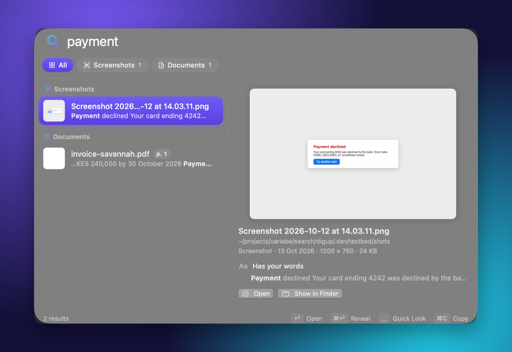

<p align="center"></p>

<h1 align="center">Variabe Search</h1>

<p align="center"><b>Describe it. Find it.</b><br>
Search everything on your Mac by what's inside it — words, pictures, sound and video —
privately, with Google DeepMind's <a href="https://huggingface.co/google/embeddinggemma-2">EmbeddingGemma 2</a>.</p>

<p align="center">Apple Silicon · macOS 14 or later · Free and open source (MIT)</p>

<p align="center"></p>

Variabe Search is a Spotlight-style search bar for your files that understands what they contain. Press **⇧⌘Space**,
say what you remember — "the clause about pets in the lease", "that payment error", "where they talk about sleep" —
and it finds the file and takes you to the page, the slide or the moment.

It runs one multimodal embedding model, EmbeddingGemma 2, that puts text, images, audio and video into a single
shared space: a photo of a dog on a beach lands next to the words "a dog on the beach", in any of more than 100
languages. Everything is read, indexed and searched on your Mac.

## What you can find

- **Documents** — "the clause about pets in the lease" opens the PDF at the page, with your words marked
- **Slides and spreadsheets** — "our hiring plan" finds the slide; "INV-2026-0417" finds the row in the workbook
- **Screenshots and photos** — "payment declined error", "a dog on the beach", "whiteboard from Tuesday"
- **Audio and video** — "zebra in a video" or "where they talk about sleep" opens the clip at that moment
- **Across languages** — a search in English can find a note written in another language, and the other way around
  (tested on English, Arabic and Bengali; the model knows 100+)
- **Code**, if you turn it on — "code: retry a failed call with backoff" finds the function in your projects

Exact words count too. Invoice numbers, error codes and names are matched as written — in file names, document text
and the text inside screenshots — so a search gets both the meaning and the exact string.

## Private by design

Nothing you index leaves your Mac. Variabe Search goes online only once, to download the model. No account, no
telemetry, no cloud.

## Get started

Variabe Search is built from source for now (signed releases will come later).

```sh
git clone https://github.com/BarakaSoka/variabe-search && cd variabe-search
./build.sh                        # builds llama.cpp, then build.noindex/Variabe Search.app
open "build.noindex/Variabe Search.app"
```

You'll need Xcode 26 and either CMake or [uv](https://docs.astral.sh/uv/) (for llama.cpp's build). Drag the app to
Applications to keep it. On first launch it downloads the model (865 MB, once) while you pick the folders to search:
whole folders, or only some of their subfolders, with an estimate of how long the first pass takes.

## Using it

| Key | What it does |
|---|---|
| ⇧⌘Space | Opens the search bar from any app (change it in Settings) |
| ↓ ↑ | Moves through the results |
| ⌘1 … ⌘6 | Filters: All, then each kind of file the search found |
| ↩ | Opens the result: PDFs at the page, recordings at the moment, code in your editor at the line |
| Space | Quick Look, at the page or moment (once you've moved to a result) |
| ⌘↩ | Shows it in Finder |
| ⌘C | Copies the file, to paste anywhere |
| ⌘O | The same search in a bigger window, with a picture grid |

Variabe Search lives in the menu bar — the lens with a V — where you can see indexing progress, pause it, or open
Settings. It has no Dock icon.

## What it reads

Only the folders you choose:

- **Pictures and screenshots** (HEIC, JPEG, PNG, RAW, WebP and more), by what they show, and screenshots by their text
- **PDFs**, page by page, scans included. Long ones get their first 30 pages right away and the rest later (up to
  5,000 pages a file)
- **Documents**: txt, md, rtf, doc, docx, odt, html. Text that's mostly numbers is matched by its exact text only
- **PowerPoint (pptx)**, slide by slide with the speaker notes, and **Excel (xlsx)**, sheet by sheet with each sheet's
  name and header row kept with its rows. The older ppt and xls aren't read
- **Audio** of any length, as overlapping 30-second windows, so a match points to its moment
- **Video** of any length: a frame every few seconds, one per shot, plus the soundtrack

It never reads keys, certificates, password files, hidden folders like `~/.ssh`, `~/Library`, app bundles or caches.
Inside a code project (a folder with `.git`, `package.json` and the like) it reads only screenshots, unless you turn
on code search for it. It skips folders that look like datasets and never downloads cloud-only iCloud, Google Drive
or OneDrive files — keep those folders available offline to search them. Variabe Search only reads your files; it
never changes, moves or uploads them.

The first pass takes a few minutes for a few hundred files and can take an hour for a big folder. After that, a new
file is searchable a second or two after it lands.

## How it works

```
your folders ─► readers (ImageIO, PDFKit, AVFoundation, Vision for text in screenshots, a zip+XML reader for Office)
             ─► EmbeddingGemma 2 on llama.cpp (Metal), in a helper process that quits when it's done
             ─► one SQLite file: a vector for every picture, page, slide, passage, video frame and 30 s of sound,
                plus a keyword index (code search keeps a second one)
your words   ─► the same model's text part (~250 MB, only while you search) ─► nearest vectors + exact words
```

Every vector lives in the same 768-dimensional space, which is why one query can rank a video frame against a PDF
page. A search embeds your words in milliseconds and compares them with everything in the index; exact-word matches
get a boost, because no embedding holds an invoice number exactly.

## Develop

```sh
scripts/build-llama.sh            # llama.cpp at a pinned tag, with a one-line patch (a few minutes, once)
swift build && swift test         # the VariabeKit engine's tests
./build.sh                        # → build.noindex/Variabe Search.app
scripts/dev-run.sh                # runs it against a scratch index and settings (never your real ones)
```

| Target | What it is |
|---|---|
| `VariabeKit` | The engine: crawler, file readers, index store, search. No UI |
| `LlamaRuntime` | EmbeddingGemma 2 on llama.cpp |
| `variabe` | Command-line tool: `variabe index`, `search`, `status`, `eval`. The app runs it as its indexing helper |
| `VariabeApp` | The menu bar app and its search bar, window, onboarding and settings (SwiftUI + AppKit) |

`scripts/make-testbed.sh` builds a folder of test files to try it on (it needs ffmpeg), and `evals/` holds the
queries ranking changes are measured with (`variabe eval evals/synthetic.json`).

## FAQ

**How is this different from Spotlight?** Spotlight finds files by their names, text and metadata. Variabe Search
also finds them by what they show or say, and takes you to the page, slide or moment. The two work side by side.

**Why is the download 865 MB?** That's the model: the text part (310 MB) and the image and audio encoders (555 MB).
The app itself is about 20 MB.

**Will it slow my Mac down?** Only the first pass is heavy. After that it reads new files only. The model runs in a
separate process that quits when it's done, and it pauses in Low Power Mode.

**How do I remove it?** Quit it, then delete the app and `~/Library/Application Support/Variabe Search`, which holds
the model and the index. Its settings are in `~/Library/Preferences/com.variabe.search.plist`.

## Credits

Variabe Search is built on [EmbeddingGemma 2](https://huggingface.co/google/embeddinggemma-2) by Google DeepMind
(Apache 2.0), [llama.cpp](https://github.com/ggml-org/llama.cpp) (MIT) and [Sparkle](https://sparkle-project.org)
(MIT). It began as a fork of [DigUp](https://github.com/ARahim3/DigUp) by Abdur Rahim (MIT). Their license notices
ship inside the app, in `Contents/Resources/Acknowledgements.txt`.

Variabe Search isn't affiliated with Google or Apple. Gemma is a trademark of Google LLC; Mac and Spotlight are
trademarks of Apple Inc.

## License

MIT — see [LICENSE](LICENSE).
